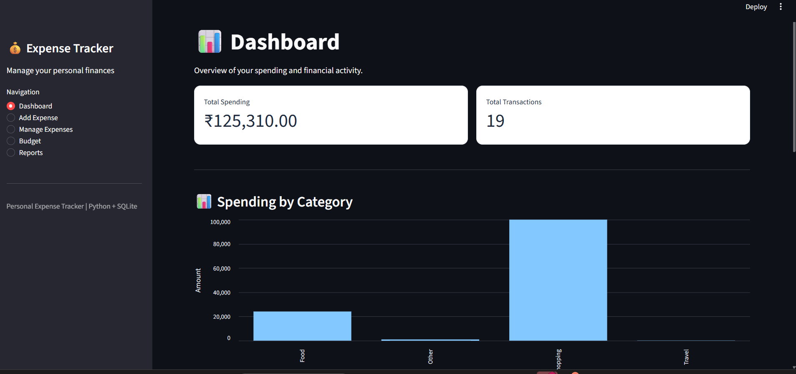
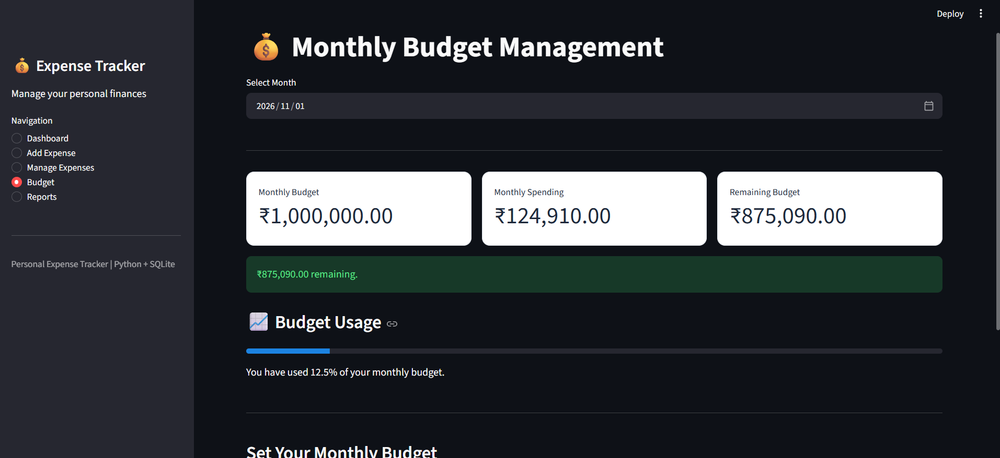
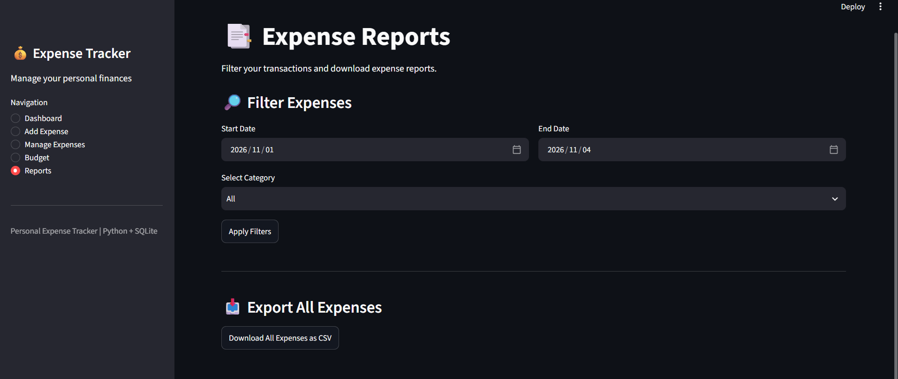

Personal Expense Tracker & Analytics

A personal finance management application built using Python, Streamlit, and SQLite. It helps users record expenses, monitor spending habits, manage monthly budgets, and analyze their expenses through an interactive dashboard.

Features

- Dashboard: View total spending and expense analytics.
- Add Expenses: Record expenses with descriptions, amounts, categories, and dates.
- Manage Expenses: View, edit, and delete saved expenses.
- Monthly Budget: Set monthly budgets and monitor remaining balances.
- Overspending Alerts: Get warnings when spending exceeds the budget.
- Expense Reports: Filter expenses by date range and category.
- CSV Export: Download expense records for further analysis.
- Database Storage: Store expense records persistently using SQLite.

Technologies Used

- Python
- Streamlit
- SQLite
- SQL

Installation and Setup

1. Clone the repository:
   
   "git clone YOUR_GITHUB_REPOSITORY_URL"

2. Navigate into the project folder:
   
   "cd expense-tracker"

3. Create a virtual environment:
   
   "python -m venv .venv"

4. Activate the virtual environment:
   
   Windows PowerShell:
   
   ".\\.venv\\Scripts\\Activate.ps1"

5. Install the required package:
   
   "pip install streamlit"

6. Run the application:
   
   "python -m streamlit run app.py"

Project Structure

- "app.py" — Streamlit user interface and application logic.
- "database.py" — SQLite database operations.
- "expenses.db" — Local database created by the application.

Learning Outcomes

- Python application development
- Building interactive interfaces with Streamlit
- Database design and SQLite integration
- Writing SQL queries
- Implementing CRUD operations
- Data filtering and expense analysis

Future Improvements

- User authentication
- Interactive spending insights
- Improved data visualization
- Cloud database integration

## Screenshots

### Dashboard

### Monthly Budget

### Expense Reports
